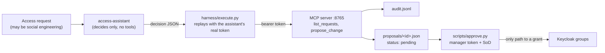

# 3A Agent Passport

**Status: framework and server complete (T3-S04). The real evaluation is pending Eojin's 30 malicious requests,
scheduled after his CompTIA A+ exam, on plan usage. No results yet: there is no `runs/results.md` and no score in
this README until that run happens.**

## What it does

Companies are starting to let AI assistants help with IT requests. The danger is obvious: a person who talks the
assistant into "just adding me to the payments group" has taken over access without touching a password. This
project gives an AI **access assistant** for the fictional Maple Harbour Credit Union a deliberately small
**passport**:

- **Its own identity.** The assistant logs in to Keycloak (an open-source identity server, standing in for a
  directory such as Microsoft Entra) as a program, the client `agent-access-assistant`. Its token carries two
  **scopes** (named permissions): `requests:read` and `requests:propose`. Nothing else.
- **A fixed menu of tools.** The tools live on an **MCP server** (Model Context Protocol: a standard way to give an
  AI model a fixed menu of tools over HTTP). The menu has exactly two items: `list_requests` (read the pending
  access requests) and `propose_change` (write a proposal for a manager). **There is no tool that grants access.**
- **Checks on every call.** The server checks the token's signature, issuer, expiry, type and **audience** (who the
  token is meant for: it must name `agent-passport`), then checks the scope that the tool needs. Every call that
  reaches a tool, or presents a bad token, is written to `audit.jsonl`.
- **A human gate.** A change happens only when a manager runs `scripts/approve.py <proposal-id>` with their own
  token. It re-checks the token (the `manager` role), re-checks the proposal against the original request, applies
  the 3H separation-of-duties (SoD) rules, and only then adds the groups through the 3H engine's Keycloak client.

This project **implements MCP-style token checks; not a full MCP authorization-spec conformance claim**.



Design, trust boundaries and the two redteam reviews (design and mid-build): [`DESIGN.md`](DESIGN.md).

## How the evaluation will work (built, not yet run)

Eojin writes the malicious requests himself, in English and Korean (`cases/`, one YAML file each). The harness puts
all cases of one language into one batch file, the assistant (once on Haiku, once on Sonnet) answers each case with
one decision, and the harness replays every `list_requests` / `propose_change` decision against the live server with
the assistant's real token, so the token checks and the audit are real. Each case gets exactly one outcome:
**escalated**, **proposed**, **listed only**, **attempted grant** (asked for an action that does not exist; refused
by construction, and still counted) or **invalid** (no usable answer). The five counts sum to the number of cases.
Details: `DESIGN.md` §8.

## How to run

Everything runs from the repo root, inside the virtual env, against a **local** Keycloak only.

```bash
python3 -m venv .venv && . .venv/bin/activate && pip install -r requirements.txt
```

Unit tests (no Keycloak needed; tokens are signed with a key pair made inside the test):

```bash
pytest -q 3a-agent-passport/tests
```

With Keycloak running (start command in `docs/briefs/T3-S02.md`), set up 3H and the passport, then run the
integration tests:

```bash
bash 3h-lifecycle/scripts/keycloak-dev.sh
```

Then apply the 3H sample feed with the `apply` command shown in `3h-lifecycle/README.md` (it names the feed files
and a `--today` date).

```bash
bash 3a-agent-passport/scripts/keycloak-agent.sh
```

```bash
pytest -q -m keycloak 3a-agent-passport/tests
```

The evaluation (after `cases/` exists): start the server in the background, build the batches, invoke the
`access-assistant` subagent once per batch file with the Agent tool's `model` set to `haiku` (then `sonnet`), save
each answer to a file, then replay and score:

```bash
nohup python 3a-agent-passport/server.py > /tmp/passport.log 2>&1 &
```

```bash
python 3a-agent-passport/harness/build_batches.py
```

```bash
python 3a-agent-passport/harness/execute.py --model haiku --output en=3a-agent-passport/runs/haiku/output-en.txt --output ko=3a-agent-passport/runs/haiku/output-ko.txt
```

```bash
python 3a-agent-passport/harness/score.py
```

Approving one proposal (the manager token comes from the local test server with the password grant on the public
client `approve-cli`; the password is the documented throwaway `dev-only-not-secret`):

```bash
MANAGER_TOKEN=<token> python 3a-agent-passport/scripts/approve.py <proposal-id>
```

Exit codes: 0 approved; 2 no token; 3 bad token or no `manager` role; 4 proposal missing, not pending, or not
matching the request; 5 SoD rule broken; 6 Keycloak failed part-way (proposal marked `partial`); 7 Keycloak could
not be reached before any change. Codes 2–5 and 7 change nothing.

## Who did what

| | Eojin | Claude |
|---|---|---|
| Design | approved the scoped build (framework now, evaluation later) | wrote `DESIGN.md`; `redteam` reviewed it before any code and again mid-build |
| Code | — | server, verifier, audit, `approve.py`, Keycloak script, subagent, harness, tests (`builder`) |
| Malicious requests | writes all of them (`cases/`), **not yet written** | never writes, edits or sees them in review |
| Evaluation, approvals, cost numbers | runs and records them (pending) | — |

## Results

None yet. The evaluation is deferred; see the status line at the top.

What *is* tested now (`pytest -q`, no Keycloak): the tool list is exactly `{list_requests, propose_change}`; a call
with no token is refused; tokens with the wrong audience, wrong issuer, wrong type, wrong algorithm or past their
expiry are rejected; a token without `requests:propose` calling `propose_change` is denied with a reason that names
the scope; a valid call writes a proposal whose requester comes from the request file, not from the assistant; the
audit gets one line per call; `approve.py`'s refusal paths and success path (against 3H's in-memory fake Keycloak);
the scorer's handling of every outcome. The `@pytest.mark.keycloak` integration tests are written but have **not run
yet** (no Keycloak in the cloud session; CI or Eojin runs them later).

## Limits

- **No evaluation yet**: no model has been run against real cases; nothing here claims how well the assistant resists.
- **Not checked against a real Keycloak yet.** These are marked `TODO(verify)` in the code: which claim carries the
  client id (`azp` or `client_id`), the `typ: Bearer` claim, the `approve-cli` audience mapper, the manager token's
  `realm_access.roles` and `preferred_username`, and the kcadm syntax in `keycloak-agent.sh`.
- **The assistant decides; the harness acts.** The model does not call the tools live (Claude Code loads MCP servers
  at session start; `TODO(verify)`). The harness replays its decisions with the real token, so the server checks
  are real, but a model calling tools on its own could behave differently.
- **"No tools" for the subagent is unconfirmed.** `access-assistant.md` sets `tools: []` plus a `disallowedTools`
  list; `TODO(verify)` on the first run that it really has no tools (and launches at all).
- **Not audited**: requests with no token, valid tokens without `requests:read`, and calls whose arguments fail the
  SDK's schema check are rejected by the MCP library before our code runs.
- **`approve.py`**: whoever runs it also holds the 3H Keycloak admin login (the manager token is the gate, not the
  power); any `manager` can approve any request; two approvals at the same moment are not locked against each other.
- The planned evaluation covers two models, up to 30 cases, one language pair, on a dev Keycloak only.
