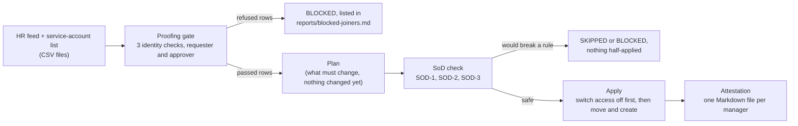

# 3H Lifecycle for People and Service Accounts

Status: built (sessions T3-S02 and T3-S03). The engine creates, moves and disables accounts from an HR feed, refuses
rows that fail identity or separation-of-duties checks, and writes a quarterly attestation per manager.

## What it does

When a company hires, moves or loses staff, their computer accounts must change to match. Doing that by hand is how
people end up with access they should no longer have (a classic cause of account takeover and of audit findings).
This project is a small Python program that reads an HR file and makes the directory match it, **and refuses to do
the dangerous things**: it will not create an account for someone whose identity was not fully checked, it will not
let one person both start and approve a payment, and it will not leave a program running with no owner.

The "directory" here is **Keycloak**, an open-source identity server. It stands in for a corporate directory such
as Microsoft Entra. Everything runs on a local test server with made-up data for a fictional credit union, Maple
Harbour (`mapleharbour.example`).



Words used below:

- **Joiner**: someone new. The engine creates their account and puts them in the right groups.
- **Mover**: someone who already has an account and changes department or job title. Their groups are made equal to
  what the new role needs: missing groups are added and groups they no longer need are removed.
- **Leaver**: someone who left. Their account is **disabled, never deleted**. Their group memberships are kept
  as evidence, and the engine records the date in an attribute called `disabled_on`.
- **Service account**: an account used by a program, not a person (for example a nightly job). Here each one is
  a Keycloak "client" with an owner, a purpose and an expiry date.
- **Group**: a named set of permissions in Keycloak. `roles-map.yaml` says which groups each department and job
  title gets (for example the job title *Payments Officer* gets `payments-initiate`).
- **Managed group**: a group the engine is allowed to add or remove. `roles-map.yaml` lists them all in
  `managed_groups`, including old groups no longer handed out. Any group not on that list is never touched.
- **Idempotent** (safe to repeat): running the engine twice with the same HR file changes nothing the second
  time. This is what makes it safe to run on a schedule or after a crash.
- **Separation of duties (SoD)**: no single person can do something risky alone. At a credit union the risky thing
  is moving money.
- **Attestation**: a manager confirms, line by line, that each person and service account they answer for should
  still have access.

### The controls

The proofing gate (written in `lifecycle/engine.py`):

- A joiner is created only when all three checks in the feed are `true`: `id_checked_live_video`,
  `references_contacted`, `education_verified`. Otherwise the plan shows
  `BLOCKED joiner E2007: proofing incomplete - id_checked_live_video` and nothing is created.
- A joiner or mover row is also blocked when the requester and the approver are the same person, when either of them
  is the person the change is for, or when either of them has left, is disabled or cannot be found in the directory.
- Blocked rows are written to `reports/blocked-joiners.md` by `apply` ([example](reports/blocked-joiners.md)); the
  file name is kept from the first version, but it now lists every blocked row.
- **A malformed row blocks only itself.** A wrong value in one row (`True` instead of `true`, a date written
  `02/11/2026`, an id with a space, a control character, a leaver with no end date) turns that row into
  `BLOCKED row 2 E2001: column 'id_checked_live_video': 'True' must be exactly 'true' or 'false'`. Nothing is done for it,
  every other row still runs, and the row is listed under "Rows that could not be read" in the report. The same applies
  to the service-account CSV and to the `sod` command, which prints the blocked rows and says they were not checked.
  A **structural** problem still stops the whole run with a clear error: a file that cannot be read, missing
  or extra columns, or the same employee id twice (two rows for one person are ambiguous, so the engine will not
  guess which is right). Control characters in a bad value are shown as escapes, never printed raw.
- **Leaver rows are never blocked.** The gate exists to stop access being *given*. A leaver row takes access *away*;
  blocking it (for example because someone filled in the approver wrongly) would keep a former employee's
  account alive. So switching access off is always allowed.

The three SoD rules (`sod-rules.yaml`, checked by `lifecycle/sod.py`):

| Rule | What it prevents |
|---|---|
| SOD-1 | An access change asked for and approved by the same person (or by someone who left). |
| SOD-2 | One person in both `payments-initiate` and `payments-approve`: they could start a payment and approve it alone. |
| SOD-3 | A service account with no owner, or whose owner left: a program nobody answers for. |

- SOD-2 is **fail closed**: a mover or joiner who would end up in both groups is skipped completely (no group change,
  no attribute change) and reported, never half-applied. It also reads the real members of both groups in Keycloak
  and reports anyone in both, even if they are not in the feed.
- SOD-3: an ownerless service account is never created; an existing enabled one is disabled with the marker
  attribute `disabled_by_engine`. Clients that already exist in Keycloak but are not in the CSV are only
  **reported** (the engine does not manage them, so it does not touch them).
- `python -m lifecycle sod` prints every violation and exits 1 if there is any, 0 if none.
- The demo pair in `roles-map.yaml`: department `payments-ops` (gives `payments-initiate`) together with the job
  title *Finance Manager* (gives `payments-approve`) would hold both groups. The file stays valid, but loading it prints
  a `NOTE`, and the extended sample feed uses the pair on purpose (mover E3004) to show the engine stopping.

Other rules that came out of design decisions:

- A joiner whose start date is still in the future is created **disabled**, with a marker attribute
  `pending_start=<start date>`. On or after that date, the next run enables the account and removes the marker.
  Only an account carrying the marker is ever enabled by the engine, so an account that an administrator disabled is
  never switched back on.
- A leaver is disabled **now**, even if their end date is still in the future. The plan says `leaves on <date>`
  or `left <date>`. This fails safe: better to cut access early than late.
- Disabling a person also **ends their sessions and revokes their offline tokens**, and it does this *before*
  writing the `disabled_on` marker, so a half-finished job is simply redone by the next run.
- A service account whose expiry date has passed is created **disabled**, or switched to disabled if it was
  enabled. The plan shows `expired on <date>`. The engine **never switches a disabled service account back
  on**, even if the owner extends the expiry date: it may have been disabled by an administrator or by the engine, so
  turning it on again is a person's decision (`SKIPPED already disabled <client id> (not re-enabled)`). Owner, purpose
  and expiry from the CSV are still kept up to date.
- Order of work in `apply`: leavers first, then service accounts without an owner, then movers, then joiners and new
  accounts. If one action fails (for example creating a joiner), the error is recorded and the rest still run, so a
  failure can never keep a leaver's access alive. `apply` then exits with code 4.
- A mover or leaver with no account in Keycloak is reported as `SKIPPED unknown user <employee id>`.
- Staff whose manager has left, is disabled, has not started or cannot be found get a
  `WARNING manager has left - reassign <employee id>` line in `plan`, and appear in `unassigned.md`.
- Anyone who gains the `privileged` group has `PRIVILEGED` at the end of their plan line.
- The Keycloak username is the lower-case employee id, which does not change when a name changes.

### Attestation

`python -m lifecycle attest --quarter 2026-Q4` writes one Markdown file per manager (`<manager_id>.md`): a table of
their direct reports (job title, groups, enabled or not) and a table of the service accounts they own (purpose,
expiry, status), every row with `[ ] keep  [ ] revoke`, and a **Warnings** list. A service account is flagged
`EXPIRES SOON` when it expires within 30 days of "today" and `EXPIRED` once the date has passed. Staff of a manager who
left, and service accounts without an active owner, go to `unassigned.md`, because nobody can attest them yet.
An example: [reports/attestation/E1001.md](reports/attestation/E1001.md). The engine never acts on the ticks; a
person does. An owner of a service account who is not a manager also gets a file.

### Why some things are built the way they are

- **Why logging out is not enough for a leaver.** Disabling an account stops *new* logins. Keycloak keeps the old
  login sessions, and keeps *offline tokens* (long-lived passes that let an app keep a login alive without the user,
  made for things like a phone app). A logout call ends the normal sessions but leaves offline tokens alone, and
  both come back to life if the account is ever switched on again. So the engine disables, logs out, and then
  deletes every consent the user has (Keycloak's way to revoke offline tokens). It writes the date marker last.
- **Why attributes are read flat but written back raw.** Keycloak stores every attribute as a list of values. The
  engine only ever needs one value per attribute, so it reads the first value to compare. But when it updates a
  user it sends back every attribute it does *not* manage exactly as Keycloak gave it, including lists with several
  values, and only replaces its own keys. Flattening on the way back would silently destroy other systems' data.
- **SKIPPED, BLOCKED and WARNING.** `BLOCKED` means a control refused the row (identity checks, requester and
  approver, SOD-3): a person must fix the data. `SKIPPED` means the engine chose not to act (an unknown user, an
  account already disabled by someone, a SOD-2 conflict). `WARNING` means it acted but a person should look (a manager
  who has left). None of the three changes Keycloak.
- **Why the plan puts leavers first.** See the order of work above.

## How to run it

All commands run from the repository root. You need Python 3.12 or newer.

```bash
# 1. One-time: a private Python environment (never install packages system-wide)
python3 -m venv .venv && . .venv/bin/activate && pip install -r requirements.txt

# 2. Start a local Keycloak (about 45 seconds the first time) in the background
nohup env KC_BOOTSTRAP_ADMIN_USERNAME=admin KC_BOOTSTRAP_ADMIN_PASSWORD=dev-only-not-secret \
  /opt/keycloak/bin/kc.sh start-dev --http-port=8080 > /tmp/keycloak.log 2>&1 &
curl -s -o /dev/null -w '%{http_code}\n' http://localhost:8080/realms/master   # wait for 200

# 3. Create the realm, groups, role and the nine existing staff accounts (safe to run again)
bash 3h-lifecycle/scripts/keycloak-dev.sh
#    Add --reset to delete realm maple-harbour first and start clean. It refuses to run
#    against anything but localhost.

# 4. See what would change, then change it, then see that nothing is left to do
export PYTHONPATH=3h-lifecycle
FILES="--feed 3h-lifecycle/hr/hr-feed.csv --service-accounts 3h-lifecycle/hr/service-accounts.csv --realm maple-harbour"
python -m lifecycle plan  $FILES --today 2026-10-22
python -m lifecycle sod   $FILES               # separation-of-duties check: exit 1 on the sample feed
python -m lifecycle apply $FILES --today 2026-10-22
python -m lifecycle plan  $FILES --today 2026-10-22     # only BLOCKED/SKIPPED report lines remain

# 5. The same with a feed that breaks no rule: the SoD check exits 0
python -m lifecycle sod --feed 3h-lifecycle/hr/fixtures/clean-feed.csv \
  --service-accounts 3h-lifecycle/hr/fixtures/clean-service-accounts.csv --realm maple-harbour

# 6. Later: pretend it is after the joiners' start dates and apply again
python -m lifecycle apply $FILES --today 2026-11-20

# 7. Quarterly attestation (one file per manager, plus unassigned.md)
python -m lifecycle attest $FILES --today 2026-10-22 --quarter 2026-Q4 --out 3h-lifecycle/reports/attestation/
```

- `--today YYYY-MM-DD` pretends it is that day. If it is missing, the `LIFECYCLE_TODAY` environment variable is used,
  and only then the real date. It decides whether a joiner has started and whether a service account has expired.
- `plan`, `apply` and `attest` also print an **Expiry warnings** list for service accounts that are `EXPIRES SOON`
  or `EXPIRED`.
- Settings come from environment variables: `KC_URL` (default `http://localhost:8080`), `KC_ADMIN_USER`
  (default `admin`) and `KC_ADMIN_PASSWORD` (default `dev-only-not-secret`, a documented throwaway for a local
  test server that is deleted with the session and never used anywhere else).
- Exit codes: 0 fine (BLOCKED, SKIPPED and WARNING lines do not change the exit code); 1 `sod` found violations; 2 bad input or a Keycloak error; 3 unexpected error; 4 `apply`
  finished but some actions failed.
- The engine refuses `--realm master` (Keycloak's own admin realm).
- Files: `hr/hr-feed.csv` (the extended sample: 17 rows), `hr/service-accounts.csv` (5 rows), `hr/fixtures/` (the
  clean copies), `roles-map.yaml`, `sod-rules.yaml`.
- Plain `plan` against the sample shows a few lines that stay forever (BLOCKED, SKIPPED): they are reports, not changes.

Tests:

```bash
ruff check .          # style and mistakes
pytest -q             # unit tests; the Keycloak tests are skipped (with the reason) if no Keycloak is running
pytest -q -m keycloak # integration tests; needs the local Keycloak from step 2
```

The unit tests use an in-memory stand-in for Keycloak, so they need no network. The integration tests rebuild
the realm (`keycloak-dev.sh --reset`), so they only run against a local server. They cannot run in GitHub Actions
(no Keycloak there), so CI covers the unit tests only. If Keycloak is up, plain `pytest -q` runs the integration
tests too and takes a few minutes.

## What Eojin did vs what Claude did

Eojin decided:

- An already-expired service account is created **disabled** (not enabled with a warning).
- A leaver is disabled **immediately**, even when the end date is in the future.
- A joiner with a future start date is created **disabled until the start date**, using an engine-owned marker.
  (This changes the original T3-S02 criterion "6 joiners enabled".)
- The engine may only change groups listed in `managed_groups`, including retired ones.
- An ownerless service account, or one whose owner left, is never created and an existing one is disabled; staff whose
  manager left go to `unassigned.md`.

Eojin's still to do: act as one manager with an attestation file, write down in his own words what each SoD rule
prevents at a credit union, and write two feed rows (one mover, one leaver) for the class.

Claude (with Eojin's review) wrote the engine, the Keycloak client, the HR file reader, the controls, the
attestation, the dev setup script, the sample data, the tests and this document. The sample data is entirely
fictional. A second AI reviewer read the code partway through in both sessions and its findings were handled (see
`docs/verify/`).

## Results

Run on 2026-10-24 against Keycloak 26.8.1 (local dev server):

```
$ ruff check .
All checks passed!

$ KC_URL=http://localhost:9 pytest -q     # Keycloak unreachable: the Keycloak tests are skipped
133 passed, 21 skipped in 0.54s

$ pytest -q -m keycloak                    # Keycloak up
21 passed, 133 deselected in 131.14s (0:02:11)
```

What the Keycloak tests prove against the real server: a leaver's normal and offline login tokens work before `apply`
and are refused after (and stay dead even if the account is switched on again); the blocked joiners do not exist;
the SOD-2 mover was not applied and nobody holds both payment groups; the ownerless service account was never created
and a service account whose owner left was disabled and can no longer get a token; a two-value attribute the engine
does not manage survives an update; the attestation has one file per manager plus `unassigned.md`.

A manual run on the extended sample feed: `plan` showed 6 create_user, 3 move_user, 3 disable_user, 4 create_client,
5 blocked, 1 skipped; `apply` did the first four (`Applied: create_user=6, move_user=3, disable_user=3,
create_client=4`).

An example attestation file generated from the sample feed: [reports/attestation/E1001.md](reports/attestation/E1001.md)
(and [unassigned.md](reports/attestation/unassigned.md)). On the extended sample feed `sod` reports exactly three
violations, one per rule (E2010 requester equals approver; E3004 would hold both payment groups; `svc-orphan-export`
has no owner), and exits 1; on `hr/fixtures/clean-feed.csv` it reports none and exits 0.

Alignment: this project is aligned to OSFI Guideline B-13 section 3.2.7, "conducting regular attestation of access"
and "ensuring system and service accounts are securely authenticated, managed and monitored". It is a portfolio
demonstration, not a statement of compliance for any organisation. TODO(verify): confirm the section number and the
exact wording against the published guideline.

## Limits

- A malformed **leaver** row is blocked like any other, so that person keeps their access until the row is fixed.
  The BLOCKED line and the report make it prominent, but nothing fixes it automatically.
- Dev server only, with made-up data. The admin password is a documented throwaway. No real tenant or Azure
  subscription is touched. No real HR system and no email delivery: the CSV files and Markdown files stand in.
- Attestation decisions are read by a person; the engine never applies a "revoke" by itself (that would need a signed
  approval).
- The engine looks at the people in the feed, the managers, requesters, approvers and owners it names, who is in the
  two payment groups, and the service-account clients in the realm. Other staff who are not in the feed are not
  checked (for example someone whose manager left but who is not in this feed).
- Clients in Keycloak that are not in the CSV are only reported by SOD-3, never changed.
- Disabling a service account stops it getting **new** tokens. Access tokens it already holds keep working until
  they expire (minutes).
- Ending a leaver's sessions deletes **every** consent the user has, not only offline tokens.
- An owner or manager who is a joiner in the same feed: on the first run the joiner does not exist yet, so a service
  account they own is not created and staff under them get a manager warning. Once the account exists and the start date
  has passed, the next run sorts it out. This takes two runs.
- Leavers who are still named as `manager_id` get the warning above; leaver rows with an empty `manager_id` are not
  listed in any attestation file.
- The engine is idempotent only if the realm allows custom user attributes ("unmanaged attributes" set to
  ENABLED, which `keycloak-dev.sh` does). Otherwise Keycloak silently drops them and the plan would never reach zero,
  and attestation tables would show empty job titles.
- Keycloak stores each attribute as a list; the engine compares the first value of each, and sends the others back
  untouched.
- Expired service accounts are created or kept disabled; this does not guarantee nothing can use them, because that
  depends on Keycloak's own settings.
- Do not turn on debug logging for the `httpx` or `httpcore` libraries: it would log the Authorization header,
  which holds the admin token.
- The sample feed's dates are in 2026; with a different real date use `--today` to reproduce the output above.
